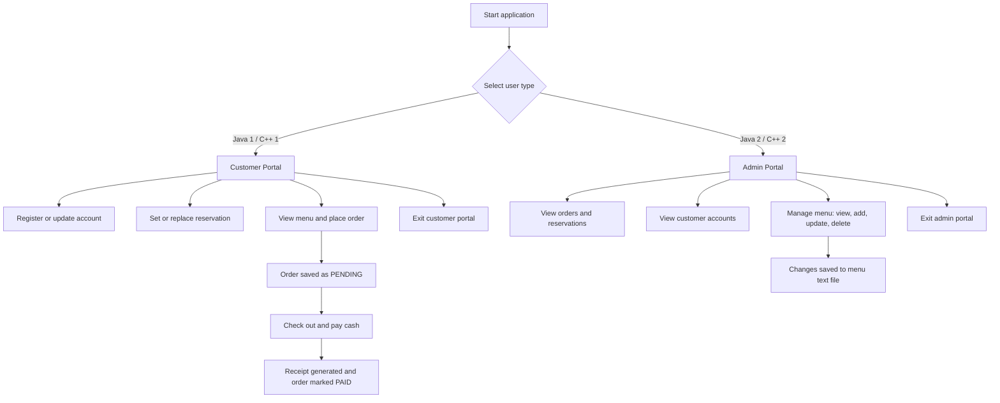
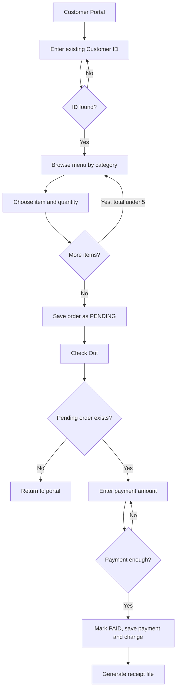
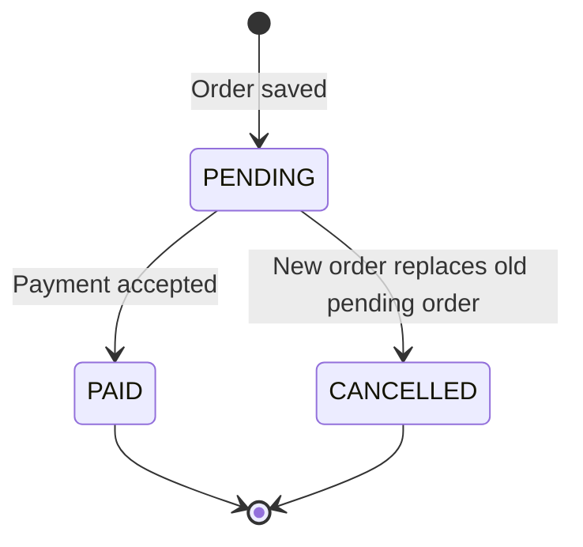

# Final Documentation — Restaurant Ordering System

**Standalone Java Edition and Standalone C++ Edition**

> **Scope note:** This documentation describes the two final applications in `Java No Integration/` and `CPP No Integration/`. Each folder is a complete, independent console application. It does **not** describe Python or any cross-language integration; the integration idea in the initial proposal was not part of the final deliverables.
>
> **How to use this file:** Sections 1–11 follow the required report structure. The console transcripts in Sections 6 and 9 are real output captured from the two programs. Blocks marked **SCREENSHOT SLOT** are placeholders — replace them with terminal screenshots when preparing the final Word/PDF report or the Canva/PowerPoint deck. **Appendix A** is a slide-by-slide outline that can be pasted directly into slides.

---

## Table of Contents

1. [Project Name, Group Name and Members](#1-project-name-group-name-and-members)
2. [Overview of the Developed Application](#2-overview-of-the-developed-application)
3. [Project Scope and Limitation](#3-project-scope-and-limitation)
4. [Client Description](#4-client-description)
5. [Flowchart of the Application](#5-flowchart-of-the-application)
6. [How the Application Works — Simple User Manual with Screenshots](#6-how-the-application-works--simple-user-manual-with-screenshots)
7. [The Practical Application or Use of the Developed Application](#7-the-practical-application-or-use-of-the-developed-application)
8. [Source Code](#8-source-code)
9. [Screenshots of the Sample Output](#9-screenshots-of-the-sample-output)
10. [Documentation Format](#10-documentation-format)
11. [References](#11-references)
    - [Appendix A — Presentation-Ready Slide Outline](#appendix-a--presentation-ready-slide-outline)

---

## 1. Project Name, Group Name and Members

| Field | Details |
|---|---|
| **Project Name** | Restaurant Ordering System — Standalone Java and C++ Editions |
| **Group Name** | `[Insert official group name here]` |
| **Course / Subject** | `[Insert course code and title here]` |
| **Submission Date** | `[Insert submission date here]` |

### Group Members

| No. | Name |
|---:|---|
| 1 | Abelardo T. Pascual IV |
| 2 | Ansel Nathaniel N. Rutab |
| 3 | Raymond Eimer M. Canapi |

> Replace the bracketed fields before submission. The initial proposal did not specify a group name or course code.

---

## 2. Overview of the Developed Application

The Restaurant Ordering System is a **text-based (CLI) application** for taking restaurant orders, managing reservations, maintaining customer accounts, editing the menu, and generating receipts. It was developed as **two separate standalone programs** with the same feature set:

- **Java No Integration** — written in Java 17, compiled with `javac`, run with `java`.
- **CPP No Integration** — written in C++17, compiled with `g++`.

Both versions serve two user types:

| User | Main abilities |
|---|---|
| **Customer** | Register and update an account, set a reservation, browse the menu, place an order (maximum 5 items), and check out with a cash payment. |
| **Admin** | View all orders and reservations, view customer accounts, and manage the menu (create, read, update, delete). |

All data is stored in **plain text files** — `BufferedReader`/`BufferedWriter` in Java and `std::ifstream`/`std::ofstream` in C++. There is **no database**, no web interface, and no integration between the two editions. They are alternative implementations of the same system, each run from its own folder with its own data files.

### Comparison of the two editions

| Aspect | Java No Integration | CPP No Integration |
|---|---|---|
| Language / standard | Java 17 | C++17 |
| Entry point | `src/Main.java` → `ordering.Main` | `src/main.cpp` |
| Launcher | `run.bat` / `run.sh` | `run.bat` / `run.sh` |
| Data location | Folder root | `data/` subfolder |
| Menu file | `menu.txt` | `data/menu.txt` |
| Orders file | `orders.txt` | `data/orders.txt` |
| Customer accounts | `Customer_Records.txt` | `data/Customer_Records.txt` |
| Reservations | `Reservations.txt` | `data/Reservations.txt` |
| Receipt location | `Customer Receipt <ID>.txt` (folder root) | `receipts/Customer Receipt <TXN-ID>.txt` |
| Menu item selection | Category letter + item number within category | Single global item number across all categories |
| Order ID generation | `TXN-<highest + 1>` from `orders.txt` | `TXN-<highest + 1>` from `data/orders.txt` |
| Role selection | `[1] Customer` / `[2] Admin` at startup | `[1] Customer Portal` / `[2] Admin Portal` / `[0] Exit` |

### Core features delivered

- Customer account registration and basic detail updates.
- Reservation creation and replacement (one reservation per customer).
- Menu browsing by category and order building with a **5-item limit**.
- Order saving with `PENDING` status and automatic cancellation of an older pending order.
- Checkout with payment validation, change computation, and receipt generation.
- Admin read-only views for orders, reservations, and customer accounts.
- Admin menu CRUD saved back to the menu text file.
- Input validation and friendly re-prompts for invalid menu choices, IDs, quantities, and amounts.

---

## 3. Project Scope and Limitation

### In scope (implemented)

- Text-based user interface (CLI) for both editions.
- Customer flows: account registration/update, reservation, menu browsing, ordering, checkout, receipt.
- Admin flows: view orders and reservations, view customer accounts, manage menu items (add, update, delete, view).
- Persistence using text files only — no database connection.
- Simulated cash payment: amount tendered and change computed; no external payment gateway.
- Basic input validation and error handling.

### Out of scope (not implemented)

- Website, mobile app, or graphical desktop UI.
- Database connection (MySQL, SQLite, etc.).
- Digital payment processing (bank cards, GCash, Maya, and similar services).
- Advanced customer profile editing (address, password, payment details, and similar fields).
- User authentication / password login. Role selection is a simple menu choice.
- Python or any integration between Java and C++. The two programs do not share data or run together.
- Inventory / stock tracking, discounts, taxes, or delivery features.

### Limitations

| Limitation | Effect |
|---|---|
| Text-file storage | Data is edited by parsing `|`-delimited lines. Manual editing with a `|` in a field can break records; the programs validate user-entered fields to prevent this. |
| No authentication | Anyone at the terminal can select the Admin portal. |
| One pending order per customer | Placing a new order automatically cancels the customer's previous `PENDING` order. |
| Five-item order limit | A customer can order at most 5 items (quantity included) per order. |
| No real payment | Payment is a number typed at the prompt; insufficient payment is rejected, but no money moves. |
| Separate data stores | The Java and C++ editions keep separate files. An order made in one edition is not visible in the other. |
| C++ menu numbering | Menu items are numbered globally across all categories, so item numbers shift when items are added or deleted. |
| Java receipt naming | Java writes `Customer Receipt <ID>.txt`, so a later checkout for the same customer overwrites the earlier receipt. C++ writes one file per order ID. |
| Local file paths | Data files are opened relative to the current folder; run each program from inside its own folder. |

### Change from the initial proposal

The proposal targeted a single CLI application integrating Java, C++, and Python. The final deliverables are **two independent applications** — Java-only and C++-only — each implementing the ordering, account, reservation, billing, and admin menu-CRUD features. Python is not part of the final presentation.

---

## 4. Client Description

The target clients were identified in the initial proposal and remain the intended users of the two standalone editions.

| Target client | Description | How the application helps |
|---|---|---|
| **Small food businesses** | Owner-operated restaurants, cafés, or food stalls with a small number of staff and no existing POS system. | Provides a low-cost way to record orders, reservations, and menu changes using only a computer terminal and text files. No database setup or subscription is required. |
| **Students** | Students who need a practical project for programming, software engineering, or database/file-handling courses. | Demonstrates console I/O, object-oriented design, file handling, validation, and CRUD operations in both Java and C++. |
| **Customers** | Individuals ordering food at the counter or for a reserved table. | Lets them register an account, set a reservation, choose items from the current menu, and receive a printed-style receipt after payment. |

### User roles within the application

| Role | Java selection | C++ selection | Responsibility |
|---|---|---|---|
| Customer | `[1] Customer` | `[1] Customer Portal` | Creates/manages own account and reservation, places orders, pays, and receives a receipt. |
| Admin | `[2] Admin` | `[2] Admin Portal` | Monitors orders/reservations/accounts and keeps the menu up to date. |

> The system assumes one shared terminal. It does not support remote access, multiple concurrent users, or per-user passwords.

---

## 5. Flowchart of the Application

### 5.1 Overall application flow



**Plain-text version (for pasting into Canva / PowerPoint):**

```text
START
  |
  v
SELECT USER TYPE ---- [Customer] ----> CUSTOMER PORTAL
  |                                     |
  |                                     +-- Register / Update Account
  |                                     +-- Set Reservation
  |                                     +-- View Menu & Place Order
  |                                          |
  |                                          v
  |                                     Order saved (PENDING)
  |                                          |
  |                                          v
  |                                     Check Out -> Pay Cash
  |                                          |
  |                                          v
  |                                     Receipt + Order marked PAID
  |
  +---------- [Admin] -----------------> ADMIN PORTAL
                                          |
                                          +-- View Orders & Reservations
                                          +-- View Customer Accounts
                                          +-- Manage Menu (view/add/update/delete)
                                               |
                                               v
                                          menu.txt updated
```

### 5.2 Customer ordering and checkout flow



### 5.3 Admin menu CRUD flow

```text
ADMIN PORTAL -> [3/4] Manage Menu
                    |
                    +-- [1] View Menu      -> display all categories and prices
                    +-- [2] Add Item       -> choose category -> name -> price -> save
                    +-- [3] Update Item    -> choose item -> blank keeps old value -> save
                    +-- [4] Delete Item    -> choose item -> [Y/N] confirmation -> save
                    +-- [X/0] Back
```

### 5.4 Order lifecycle



`PENDING` orders remain visible to the admin and can be checked out later — even in a new session, because the item summary is stored in the orders file.

---

## 6. How the Application Works — Simple User Manual with Screenshots

### 6.1 Requirements and launching

| Requirement | Java edition | C++ edition |
|---|---|---|
| Compiler / runtime | JDK 8 or newer (verified with Java 17) | C++17 compiler (verified with g++ 16.2.0) |
| Tools on `PATH` | `javac`, `java` | `g++` |
| Working folder | `Java No Integration/` | `CPP No Integration/` |

**Java — Windows / Linux / macOS**

```bat
cd "Java No Integration"
run.bat
```

or manually:

```bat
javac -d out src\*.java
java -cp out ordering.Main
```

**C++ — Windows**

```bat
cd "CPP No Integration"
run.bat
```

or manually:

```powershell
g++ -std=c++17 -Wall -Wextra -I .\src .\src\*.cpp -o RestaurantOrderingSystem.exe
.\RestaurantOrderingSystem.exe
```

**C++ — Linux / macOS**

```bash
cd "CPP No Integration"
chmod +x run.sh
./run.sh
```

> Data files are read from the current working directory. Always run from inside the correct folder.

---

### 6.2 Java edition user manual

**Step 1 — Select role**

```text
SELECT USER TYPE
[1] Customer
[2] Admin
Choice:
```

Only `1` or `2` is accepted; other input is re-prompted.

**Step 2 — Customer portal**

| Option | Action |
|---|---|
| `[1] Register Account` | Enter a new positive customer ID, full name, and contact number. The ID becomes the signed-in customer for this session. |
| `[2] Update Account Details` | Change name and/or contact. Press Enter on a field to keep the current value. |
| `[3] View Menu & Place Order` | Ask for an existing customer ID, browse the menu, and build an order. |
| `[4] Set Reservation` | Enter customer ID, date, time, and number of guests. A new entry replaces that customer's old reservation. |
| `[5] Check Out` | Pay the pending order and print the receipt. |
| `[X] Exit System` | Leave the portal. An unpaid order stays visible to the admin. |

**Step 3 — Order menu**

```text
ORDER MENU
[A] Meals
[B] Drinks
[C] Desserts
[D] Side Dishes
[E] Bundles
[V] View Current Order
[X] Finish & Save Order
Items in order: 0/5
```

Choose a category letter, then an item number and quantity. Repeated selection of the same item increases its quantity. A quantity that would exceed the 5-item limit is rejected. Press `[V]` to review, then `[X]` to save the order as `PENDING`.

**Step 4 — Check out**

The program shows the order ID, customer, item summary, and amount due. Type a payment amount, or `[X]` to cancel. Insufficient payment is rejected with the remaining balance shown. On success, the order becomes `PAID`, `orders.txt` is updated, `Customer Receipt <ID>.txt` is written, and the receipt is printed on screen.

**Step 5 — Admin portal**

| Option | Action |
|---|---|
| `[1] View Orders & Reservations` | Table of all orders (ID, customer, status, total, items) and all reservations. |
| `[2] View Customer Accounts` | Read-only table of IDs, names, and contacts. |
| `[3] Manage Menu` | View / add / update / delete menu items. |
| `[X] Exit System` | End the admin session. |

Inside **Manage Menu**: `[1]` View Menu, `[2]` Add Menu Item, `[3]` Update Menu Item, `[4]` Delete Menu Item, `[X]` Back. Categories are chosen with `[A]` Meals, `[B]` Drinks, `[C]` Desserts, `[D]` Side Dishes, `[E]` Bundles. Updates accept blank entries to keep the old name or price. Deletion requires `[Y/N]` confirmation. All changes are saved to `menu.txt`.

**Data files (Java edition)**

| File | Format | Purpose |
|---|---|---|
| `menu.txt` | `CATEGORY|name|price` | Menu items editable by the admin. Recreated with defaults if missing. |
| `Customer_Records.txt` | `ID|Name|Contact` | Customer accounts. Seed account: `25|Abe|239120`. |
| `Reservations.txt` | `customerId|date|time|guests` | One reservation per customer. |
| `orders.txt` | `orderId|customerId|status|total|payment|change|summary` | Order history and status. |
| `Customer Receipt <ID>.txt` | Human-readable | Receipt written at checkout. |

---

### 6.3 C++ edition user manual

**Step 1 — Main menu**

```text
================================
    RESTAURANT ORDERING SYSTEM
================================
[1] Customer Portal
[2] Admin Portal
[0] Exit System
================================
Enter choice:
```

**Step 2 — Customer portal**

| Option | Action |
|---|---|
| `[1] Register Account` | Enter name and contact; the program assigns the next ID automatically. |
| `[2] Update Account Details` | Enter customer ID, then new name/contact; blank keeps the old value. |
| `[3] View Menu & Place Order` | Enter customer ID, select items by their global menu number, then `0` to finish. |
| `[4] Set Reservation` | Enter customer ID, date (`YYYY-MM-DD`), time, and guests. |
| `[5] Check Out` | Enter customer ID, then payment amount or `X` to cancel. |
| `[0] Return to Main Menu` | Leave the customer portal. |

**Step 3 — Placing an order**

The menu is displayed once as a single numbered list grouped by category (Meals, Drinks, Desserts, Sides, Bundles). Enter an item number, then a quantity within the remaining allowance. The program shows an order summary with per-item totals and the overall total before saving. Enter `0` at the item prompt to finish. The order is saved to `data/orders.txt` with status `PENDING`, and any older pending order for that customer is marked `CANCELLED`.

**Step 4 — Check out**

The program asks for the customer ID, finds the pending order, shows its details, then asks for payment. `X` cancels and leaves the order pending. Insufficient payment shows the remaining balance. On success, the order status becomes `PAID`, payment and change are stored, and `receipts/Customer Receipt <TXN-ID>.txt` is generated.

**Step 5 — Admin portal**

| Option | Action |
|---|---|
| `[1] View All Orders` | Full details of every order, ending with the total number of orders. |
| `[2] View All Reservations` | Table of customer IDs, dates, times, and guest counts. |
| `[3] View Customer Accounts` | Read-only table of IDs, names, and contacts. |
| `[4] Manage Menu` | View / add / update / delete menu items. |
| `[0] Return to Main Menu` | Leave the admin portal. |

Inside **Manage Menu**: `[1]` View Menu, `[2]` Add Menu Item (choose category `1`–`5`), `[3]` Update Menu Item (enter global item number), `[4]` Delete Menu Item (with `[Y/N]` confirmation), `[0]` Return. Changes are saved to `data/menu.txt`.

**Data files (C++ edition)**

| File | Format | Purpose |
|---|---|---|
| `data/menu.txt` | `CATEGORY|name|price` | Menu items editable by the admin. Default menu generated if missing. |
| `data/Customer_Records.txt` | `ID|Name|Contact` | Customer accounts. Seed account: `25|Abe|239120`. |
| `data/Reservations.txt` | `customerId|date|time|guests` | Customer reservations. |
| `data/orders.txt` | `orderId|customerId|status|total|payment|change|summary` | Order history and status. |
| `receipts/Customer Receipt <TXN-ID>.txt` | Human-readable | Receipt generated at checkout. |

---

### 6.4 Screenshot slots for the manual

> Replace each block with an actual terminal screenshot. The text below each slot can be used as the slide/report caption.

**SCREENSHOT SLOT 1 — Role selection (Java)**  
Caption: *Startup screen showing the Customer / Admin role prompt.*

**SCREENSHOT SLOT 2 — Customer placing an order (Java)**  
Caption: *Order menu with category letters, item list, quantity entry, and 5-item counter.*

**SCREENSHOT SLOT 3 — Checkout and receipt (Java)**  
Caption: *Payment accepted; receipt printed with total, payment, and change.*

**SCREENSHOT SLOT 4 — Admin menu management (Java)**  
Caption: *Admin portal showing menu add / update / delete options.*

**SCREENSHOT SLOT 5 — Main menu (C++)**  
Caption: *C++ main menu with Customer Portal, Admin Portal, and Exit.*

**SCREENSHOT SLOT 6 — Menu and order summary (C++)**  
Caption: *Numbered global menu list and order summary before saving.*

**SCREENSHOT SLOT 7 — Admin views (C++)**  
Caption: *Admin panel listing all customer orders and accounts.*

---

## 7. The Practical Application or Use of the Developed Application

### Real-world use case

A small restaurant can run either edition on a single counter computer. A staff member selects the **Customer** role on behalf of a diner, registers the customer if needed, records a reservation, builds the order from the current menu, and collects cash at checkout. The program prints a receipt and updates the order file. At the end of the day, staff selects the **Admin** role to review orders and reservations and to update prices or menu items for the next day.

### Practical value

| Use | Benefit |
|---|---|
| Order taking | Reduces handwritten errors; prices and totals are computed automatically. |
| Receipt generation | Produces a consistent, itemized receipt for the customer. |
| Reservation tracking | Keeps one reservation per customer with date, time, and guest count. |
| Menu maintenance | Admin can add, rename, reprice, or remove items without editing source code. |
| Order status visibility | Admin can see `PENDING`, `PAID`, and `CANCELLED` orders. |
| Learning / demonstration | Shows file-based CRUD, validation, and object-oriented structure in two languages. |

### Where each edition fits

- **Java edition:** suitable for Java-focused coursework and for environments where the JDK is already available. It uses package `ordering` and `BufferedReader`/`BufferedWriter`.
- **C++ edition:** suitable for C++-focused coursework and for demonstrating standard library streams, `std::vector`, and structured console programs without a framework.

### Practical boundary

The applications are **demonstration / small-scale tools**, not production POS systems. They do not support multiple simultaneous users, real payment gateways, accounts with passwords, or networked data sharing. For a live business, a database, authentication, and secure payment processing would be required.

### Possible future extensions (not implemented)

- Password-based admin and customer login.
- Database storage replacing text files.
- Digital payment integration.
- Stock/inventory tracking and low-stock warnings.
- Separate `CustomerMenu` and `AdminMenu` modules with a shared menu file.
- A GUI or web front end.

---

## 8. Source Code

The complete source code is in the two project folders. The excerpts below show the entry points and the main modules; abridged sections are marked with `// ...` or `/* ... */`.

### 8.1 Source layout — Java No Integration

```text
Java No Integration/
├── src/
│   ├── Main.java                  # role selection and startup
│   ├── Console.java               # shared, validated input helpers
│   ├── Menu.java                  # persistent menu + default items
│   ├── MenuItem.java              # one menu item
│   ├── CustomerRecord.java        # one customer account
│   ├── CustomerRepository.java    # reads/writes Customer_Records.txt
│   ├── CustomerRecordService.java # register / update / view accounts
│   ├── Reservation.java           # one reservation
│   ├── ReservationRepository.java # reads/writes Reservations.txt
│   ├── ReservationService.java    # set a reservation
│   ├── Order.java                 # order entity + status lifecycle
│   ├── OrderItem.java             # one order line
│   ├── OrderCalculator.java       # subtotal and 2-decimal rounding
│   ├── OrderRepository.java       # reads/writes orders.txt
│   ├── OrderService.java          # menu browsing and ordering
│   ├── BillingService.java        # checkout and payment
│   ├── ReceiptRenderer.java       # receipts and admin tables
│   ├── CustomerPortal.java        # customer portal
│   └── AdminService.java          # admin portal and menu management
├── menu.txt
├── Customer_Records.txt
├── Reservations.txt
├── orders.txt
└── run.bat / run.sh
```

### 8.2 Source layout — CPP No Integration

```text
CPP No Integration/
├── src/
│   ├── main.cpp                   # application entry point
│   ├── Console.h / Console.cpp
│   ├── CustomerRecord.h / .cpp
│   ├── CustomerRepository.h / .cpp
│   ├── CustomerRecordService.h / .cpp
│   ├── MenuItem.h / .cpp
│   ├── Menu.h / .cpp
│   ├── Reservation.h / .cpp
│   ├── ReservationRepository.h / .cpp
│   ├── ReservationService.h / .cpp
│   ├── OrderItem.h / .cpp
│   ├── Order.h / .cpp
│   ├── OrderCalculator.h / .cpp
│   ├── OrderRepository.h / .cpp
│   ├── OrderService.h / .cpp
│   ├── BillingService.h / .cpp
│   ├── ReceiptRenderer.h / .cpp
│   ├── CustomerPortal.h / .cpp
│   └── AdminService.h / .cpp
├── data/                          # menu.txt, Customer_Records.txt,
│                                  # Reservations.txt, orders.txt
├── receipts/                      # generated receipt files
└── run.bat / run.sh
```

### 8.3 Java — key excerpts

**`src/Main.java` — entry point and role selection**

```java
package ordering;

import java.util.Scanner;

public final class Main {
    private static final Scanner SCANNER = new Scanner(System.in);
    private static final Console CONSOLE = new Console(SCANNER);

    public static void main(String[] args) {
        try {
            run();
        } catch (Console.EndOfInputException exception) {
            System.out.println("\nInput stream closed. Exiting.");
        } finally {
            SCANNER.close();
        }
    }

    private static void run() {
        Menu menu = Menu.load();
        CustomerRepository customers = new CustomerRepository();
        ReservationRepository reservations = new ReservationRepository();
        OrderRepository orders = new OrderRepository();

        String role = selectRole();
        System.out.println("Logged in as: " + ("ADMIN".equals(role) ? "Admin" : "Customer") + "\n");

        if ("ADMIN".equals(role)) {
            new AdminService(CONSOLE, menu, customers, reservations, orders).run();
        } else {
            new CustomerPortal(CONSOLE, menu, customers, reservations, orders).run();
        }
    }

    private static String selectRole() {
        System.out.println("SELECT USER TYPE");
        System.out.println("[1] Customer");
        System.out.println("[2] Admin");
        while (true) {
            System.out.print("Choice: ");
            String choice = CONSOLE.readLine();
            if (choice.equals("1")) return "CUSTOMER";
            if (choice.equals("2")) return "ADMIN";
            System.out.println("Please enter [1] for Customer or [2] for Admin.");
        }
    }
}
```

**`src/OrderService.java` — order capture and the 5-item limit**

```java
public Order placeOrder(int customerId) {
    List<OrderItem> items = new ArrayList<>();

    while (true) {
        printOrderMenu(items);
        char choice = console.readChoice();

        if (choice == 'X') {
            if (items.isEmpty()) {
                System.out.println("No items selected. Returning to the main menu without creating an order.");
                return null;
            }
            Order order = new Order(orders.nextOrderId(), customerId, items);
            orders.add(order);
            System.out.println("Order " + order.orderId() + " saved with status "
                    + order.status() + ". Choose [5] Check Out when you are ready to pay.");
            return order;
        }
        // ... [V] view current order, category selection ...
    }
}

private void addItem(String category, List<OrderItem> items) {
    // ... print items in the category ...
    MenuItem selected = available.get(choice - 1);
    int quantity = console.readPositiveInt("Quantity: ");
    if (totalQuantity(items) + quantity > MAX_ITEMS) {
        System.out.println("You can order at most " + MAX_ITEMS + " items in total.");
        return;
    }
    mergeOrAdd(items, selected, quantity);
}
```

**`src/BillingService.java` — payment validation and receipt**

```java
while (true) {
    System.out.print("Enter payment amount (or [X] to return to the main menu): PHP ");
    String line = console.readLine();
    if (line.equalsIgnoreCase("X")) {
        System.out.println("Checkout cancelled. Returning to the main menu.");
        return false;
    }
    double payment;
    try {
        payment = Double.parseDouble(line);
    } catch (NumberFormatException exception) {
        System.out.println("Please enter a valid amount, or [X] to go back.");
        continue;
    }
    if (!Double.isFinite(payment) || payment <= 0) { /* re-prompt */ }
    if (payment < total) {
        System.out.printf(Locale.US, "Insufficient payment. You still need PHP %.2f.%n", total - payment);
        continue;
    }
    order.markPaid(payment);
    orders.save(order);
    ReceiptRenderer.writeCustomerReceipt(order, customer);
    ReceiptRenderer.printCustomerReceipt(order, customer);
    return true;
}
```

**`src/AdminService.java` — menu management options**

```java
private void manageMenu() {
    while (true) {
        System.out.println("\nMENU MANAGEMENT");
        System.out.println("[1] View Menu");
        System.out.println("[2] Add Menu Item");
        System.out.println("[3] Update Menu Item");
        System.out.println("[4] Delete Menu Item");
        System.out.println("[X] Back to Admin Portal");

        char choice = console.readChoice();
        switch (choice) {
            case '1': viewMenu();   break;
            case '2': addItem();    break;
            case '3': updateItem(); break;
            case '4': deleteItem(); break;
            case 'X': return;
            default:  System.out.println("Invalid option.");
        }
    }
}
```

### 8.4 C++ — key excerpts

**`src/main.cpp` — entry point**

```cpp
#include <iostream>
#include "Console.h"
#include "CustomerPortal.h"
#include "AdminService.h"

int main() {
    CustomerPortal customerPortal;
    AdminService adminService;
    int choice;

    do {
        Console::clearScreen();
        cout << "================================\n";
        cout << "    RESTAURANT ORDERING SYSTEM\n";
        cout << "================================\n";
        cout << "[1] Customer Portal\n";
        cout << "[2] Admin Portal\n";
        cout << "[0] Exit System\n";
        cout << "================================\n";

        choice = Console::getInt("Enter choice: ");

        switch (choice) {
            case 1: customerPortal.show(); break;
            case 2: adminService.show();   break;
            case 0: cout << "Thank you for using the system!\n"; break;
            default:
                cout << "Invalid choice.\n";
                Console::pause();
        }
    } while (choice != 0);

    return 0;
}
```

**`src/OrderService.cpp` — order saving**

```cpp
// Delete/cancel the customer's previous pending order.
for (Order& order : orders) {
    if (order.getCustomerId() == customerId && order.getStatus() == "PENDING") {
        order.setStatus("CANCELLED");
    }
}

string orderId = orderRepository.generateNextId(orders);
Order newOrder(orderId, customerId, "PENDING", total, 0.0, 0.0, summary);
orders.push_back(newOrder);

if (orderRepository.saveOrders(orders)) {
    cout << "\nOrder successfully saved!\n";
    cout << "Order ID: " << orderId << "\n";
    cout << "Status: PENDING\n";
    cout << "Your order is waiting for checkout.\n";
}
```

**`src/BillingService.cpp` — payment**

```cpp
if (input == "X" || input == "x") {
    cout << "\nCheckout cancelled. Your order remains pending.\n";
    return false;
}
double enteredAmount = stod(input, &processed);
if (processed != input.length() || enteredAmount <= 0) { /* re-prompt */ }
if (enteredAmount < total) {
    cout << "Insufficient payment. You still owe PHP "
         << fixed << setprecision(2) << total - enteredAmount << "\n";
    continue;
}
payment = enteredAmount;
change = payment - total;
return true;
```

**`src/ReceiptRenderer.cpp` — receipt file output**

```cpp
filesystem::create_directories("receipts");
string filePath = "receipts/Customer Receipt " + order.getOrderId() + ".txt";
ofstream file(filePath);

file << "========================================\n";
file << "           RESTAURANT RECEIPT            \n";
file << "========================================\n\n";
file << "Order ID:    " << order.getOrderId() << "\n";
file << "Customer ID: " << order.getCustomerId() << "\n";
file << "Status:      " << order.getStatus() << "\n";
/* ... item summary ... */
file << "Total:   PHP " << order.getTotal() << "\n";
file << "Payment: PHP " << order.getPayment() << "\n";
file << "Change:  PHP " << order.getChange() << "\n";
```

### 8.5 Data file formats

Both editions use the same field structures:

| File | Pipe-delimited format |
|---|---|
| Menu | `CATEGORY|name|price` |
| Customer record | `ID|Name|Contact` |
| Reservation | `customerId|date|time|guests` |
| Order | `orderId|customerId|status|total|payment|change|summary` |

---

## 9. Screenshots of the Sample Output

The transcripts below were captured from actual runs. Sample conditions: customer **25 (Abe)**, payment **PHP 500.00**, Java item *Meal 1 x2* (PHP 312.50), C++ item *Fried Chicken with Garlic Rice x2* (PHP 240.00).

### 9.1 Java — customer order and checkout

```text
SELECT USER TYPE
[1] Customer
[2] Admin
Choice: Logged in as: Customer

CUSTOMER PORTAL
[1] Register Account
[2] Update Account Details
[3] View Menu & Place Order
[4] Set Reservation
[5] Check Out
[X] Exit System
Customer ID (0 to return to the main menu):
ORDER MENU
[A] Meals
[B] Drinks
[C] Desserts
[D] Side Dishes
[E] Bundles
[V] View Current Order
[X] Finish & Save Order
Items in order: 0/5

MEALS
[1] Meal 1 -> Fried Chicken W/ Garlic Rice               PHP 156.25
[2] Meal 2 -> Pasta and Wings W/ Garlic Bread            PHP 184.60
[3] Meal 3 -> Steak and Fries W/ Garlic Bread            PHP 450.00
Choose an item (0 to go back): Quantity: Added Meal 1 -> Fried Chicken W/ Garlic Rice x2.

Order TXN-1002 saved with status PENDING. Choose [5] Check Out when you are ready to pay.

CHECK OUT
Order ID: TXN-1002
Customer: Abe (ID 25)
Items: Meal 1 -> Fried Chicken W/ Garlic Rice x2
Total amount due: PHP 312.50
Enter payment amount (or [X] to return to the main menu): PHP Receipt saved to Customer Receipt 25.txt.

=================================
        OFFICIAL RECEIPT
=================================
 Order ID:   TXN-1002
 Customer:   Abe (ID 25)
---------------------------------
 Meal 1 -> Fried Chicken W/ Garlic Rice x2 -> PHP 312.50
---------------------------------
 Subtotal:   PHP 312.50
 Total:      PHP 312.50
 Payment:    PHP 500.00
 Change:     PHP 187.50
=================================
 Thank you for ordering!
```

**SCREENSHOT SLOT 8 — Java checkout transcript (above)**  
Suggested caption: *Sample Java checkout: order TXN-1002, total PHP 312.50, change PHP 187.50.*

### 9.2 Java — receipt file

`Customer Receipt 25.txt`

```text
=================================
        OFFICIAL RECEIPT
=================================
 Order ID:   TXN-1002
 Customer:   Abe (ID 25)
---------------------------------
 Meal 1 -> Fried Chicken W/ Garlic Rice x2 -> PHP 312.50
---------------------------------
 Subtotal:   PHP 312.50
 Total:      PHP 312.50
 Payment:    PHP 500.00
 Change:     PHP 187.50
=================================
 Thank you for ordering!
```

### 9.3 Java — admin views

```text
ADMIN PORTAL
[1] View Orders & Reservations
[2] View Customer Accounts
[3] Manage Menu
[X] Exit System

ORDERS
Order ID     Customer                     Status     Total          Items
--------------------------------------------------------------------------------
TXN-1001     Abe (25)                     PAID       PHP 352.50    Meal 1 -> Fried Chicken W/ Garlic Rice x2; Juice x2
TXN-1002     Abe (25)                     PAID       PHP 312.50    Meal 1 -> Fried Chicken W/ Garlic Rice x2

RESERVATIONS
ID     Customer                     Date         Time           Guests
--------------------------------------------------------------------------------
25     Abe                          12/12/24     05:00 P.M      2
```

**SCREENSHOT SLOT 9 — Java admin table**  
Suggested caption: *Admin view lists every order with status and totals.*

### 9.4 C++ — customer order and payment

```text
========== PLACE ORDER ==========
Enter your Customer ID:

================ RESTAURANT MENU ================
--- MEALS ---
[1] Fried Chicken with Garlic Rice        PHP 120.00
[2] Beef Burger Steak with Rice           PHP 150.00
[3] Pork BBQ with Rice                    PHP 130.00
--- DRINKS ---
[4] Iced Tea                              PHP 35.00
[5] Lemonade                              PHP 40.00
[6] Bottled Water                         PHP 25.00
/* other categories omitted for brevity */

Items selected: 0/5
Enter 0 when you are finished selecting items.
Select item number: Enter quantity (1-5):
Added: Fried Chicken with Garlic Rice x2

========== ORDER SUMMARY ==========
Fried Chicken with Garlic Rice x2 = PHP 240.00
-----------------------------------
Total: PHP 240.00

Order successfully saved!
Order ID: TXN-1001
Status: PENDING
Your order is waiting for checkout.

========== PAYMENT ==========
Amount Due: PHP 240.00
Enter payment amount or X to cancel:
Payment accepted.
Change: PHP 260.00

Order successfully paid!
Order Status: PAID
Receipt generated successfully!
File: receipts/Customer Receipt TXN-1001.txt
```

**SCREENSHOT SLOT 10 — C++ order and payment transcript**  
Suggested caption: *C++ order capture, summary, and accepted cash payment.*

### 9.5 C++ — receipt file

`receipts/Customer Receipt TXN-1001.txt`

```text
========================================
           RESTAURANT RECEIPT
========================================

Order ID:    TXN-1001
Customer ID: 25
Status:      PAID

----------------------------------------
ORDER DETAILS
----------------------------------------
Fried Chicken with Garlic Rice x2

----------------------------------------
Total:   PHP 240.00
Payment: PHP 500.00
Change:  PHP 260.00

========================================
          THANK YOU FOR ORDERING!
========================================
```

### 9.6 C++ — admin views

```text
========== ALL CUSTOMER ORDERS ==========
----------------------------------------
Order ID:    TXN-1001
Customer ID: 25
Status:      PAID
Items:       Fried Chicken with Garlic Rice x2
Total:       PHP 240.00
Payment:     PHP 500.00
Change:      PHP 260.00
----------------------------------------
Total orders: 1

================ CUSTOMER ACCOUNTS ================
Customer ID    Name                     Contact
----------------------------------------------------
25             Abe                      239120
====================================================
Total customers: 1
```

**SCREENSHOT SLOT 11 — C++ admin views**  
Suggested caption: *C++ admin panel showing order history and customer accounts.*

### 9.7 Stored order rows

```text
Java — orders.txt
TXN-1001|25|PAID|352.50|352.50|0.00|Meal 1 -> Fried Chicken W/ Garlic Rice x2; Juice x2
TXN-1002|25|PAID|312.50|500.00|187.50|Meal 1 -> Fried Chicken W/ Garlic Rice x2

C++ — data/orders.txt
TXN-1001|25|PAID|240.00|500.00|260.00|Fried Chicken with Garlic Rice x2
```

---

## 10. Documentation Format

The report should be prepared with the following settings. Markdown cannot enforce fonts or page layout, so apply these settings in Microsoft Word / Google Docs before exporting to PDF, and keep the same visual style in Canva.

| Setting | Required value |
|---|---|
| Font style | Arial |
| Font size | 12 pt |
| Alignment | Justify |
| Orientation | Portrait |
| Margins | 1 inch on all sides |
| Paper size | 8.5 × 11 inches (Letter) |

**Application notes**

- Apply **Justify** to body paragraphs; headings may remain left-aligned.
- Use 12 pt Arial for body text; headings can use larger Arial sizes for hierarchy.
- Use 1-inch margins on top, bottom, left, and right.
- Insert screenshots at their corresponding **SCREENSHOT SLOT** markers and caption them.
- Keep code excerpts in a monospace font (for example, Consolas 10 pt) if allowed by the instructor; otherwise convert them to Arial.
- Export the final report as PDF after applying the format above.

**Canva / PowerPoint adaptation**

- Use a 16:9 presentation page for slides.
- Keep Arial as the typeface; use 12 pt as the minimum body size and larger sizes for titles.
- Redraw the flowcharts from Section 5 using Canva shapes — Mermaid code is for the report only.
- Paste each slide's text from **Appendix A** into separate text boxes; replace screenshot placeholders with captured images.

---

## 11. References

### Books

1. Bloch, J. (2018). *Effective Java* (3rd ed.). Addison-Wesley.
2. Horstmann, C. S. (2022). *Core Java Volume I — Fundamentals* (11th ed.). Oracle Press.
3. Josuttis, N. M. (2012). *The C++ Standard Library: A Tutorial and Reference* (2nd ed.). Addison-Wesley.
4. Pressman, R. S., & Maxim, B. R. (2020). *Software Engineering: A Practitioner's Approach* (9th ed.). McGraw-Hill.
5. Sommerville, I. (2016). *Software Engineering* (10th ed.). Pearson.
6. Stroustrup, B. (2013). *The C++ Programming Language* (4th ed.). Addison-Wesley.

### Unpublished research

7. Abelardo, T. P. IV, Rutab, A. N. N., & Canapi, R. E. M. (2026). *Initial project proposal: Restaurant Ordering System* (Unpublished course proposal).
8. *Java No Integration — Project README* (2026). Unpublished project documentation, `Java No Integration/README.md`.
9. *CPP No Integration — Project README* (2026). Unpublished project documentation, `CPP No Integration/README.md`.
10. *Reference notes for the ordering system* (2026). Unpublished project documentation, `REFERENCE.md`.
11. *Instructions, debugging, and polishing notes for the ordering system* (2026). Unpublished project documentation, `INSTRUCTIONS.MD`, `DEBUGGING.md`, and `POLISHING.md`.

> Replace item 7 with the exact title and course details from the submitted proposal if required by the instructor.

### Electronic references

12. Oracle. (2026). *The Java Tutorials*. Oracle Corporation. https://docs.oracle.com/javase/tutorial/
13. Oracle. (2026). *Java Platform, Standard Edition 17 API Specification*. https://docs.oracle.com/en/java/javase/17/docs/api/
14. cppreference.com. (2026). *C++ reference*. https://en.cppreference.com/
15. ISO C++ Foundation. (2026). *C++ — Learn, reference, news*. https://isocpp.org/
16. Microsoft. (2026). *C++ documentation*. https://learn.microsoft.com/en-us/cpp/
17. GCC Project. (2026). *GNU Compiler Collection documentation*. https://gcc.gnu.org/
18. Canva. (2026). *Canva documentation and help center*. https://www.canva.com/help/

---

## Appendix A — Presentation-Ready Slide Outline

Use this outline as the basis for the `.pptx`. Each slide's bullets are condensed from the numbered sections above, so the text can be copied directly into Canva text boxes. Replace every `[screenshot]` note with an image from Sections 6 and 9.

| Slide | Title | Paste-ready content | Visual suggestion |
|---:|---|---|---|
| 1 | Title | **Restaurant Ordering System**<br>Standalone Java and C++ Editions<br>`[Group name]`<br>Abelardo T. Pascual IV · Ansel Nathaniel N. Rutab · Raymond Eimer M. Canapi | Simple restaurant-themed cover; Arial, project name large. |
| 2 | Project Identity | Project name; group name; three members; two final deliverables: Java No Integration and CPP No Integration. | Three-member name cards. |
| 3 | Overview | CLI ordering system for customers and admins. Two independent implementations with the same features. Text files instead of a database. No Python or integration in the final apps. | Two side-by-side icons: Java and C++. |
| 4 | Features | Customer: register/update account, reservations, menu browsing, ordering, checkout, receipt. Admin: view orders/reservations/accounts, manage menu. | Two-column feature list. |
| 5 | Scope & Limitations | In scope: CLI, CRUD, ordering, text files. Out of scope: web/GUI, database, digital payments, advanced profiles, integration. Limitations: no login, one pending order, 5-item limit, separate data. | Checkmark / cross grid. |
| 6 | Clients | Small food businesses, students, customers. Two roles per app: Customer and Admin. | Client icons or simple table. |
| 7 | Application Flow | Start → Role selection → Customer or Admin portal → Order/Reservation or Admin views → Receipt / menu file updated. | Redraw Section 5.1 flowchart with Canva shapes. |
| 8 | Order Lifecycle | `PENDING → PAID`; `PENDING → CANCELLED` when a newer order replaces it. Pending orders stay visible to admin and can be paid later. | Three-state diagram from Section 5.4. |
| 9 | Java User Manual | Run with `run.bat`. Choose `[1]` Customer / `[2]` Admin. Customer portal `[1]`–`[5]`, `[X]` exit. Order menu `[A]`–`[E]`, `[V]`, `[X]`; 5-item cap; checkout writes receipt. `[screenshot: Java order menu]` | Place Screenshot Slots 1–3. |
| 10 | C++ User Manual | Main menu `[1]` Customer / `[2]` Admin / `[0]` Exit. Global menu numbering; enter item number and quantity; `0` to finish. Admin `[1]`–`[4]`, `[0]` back. `[screenshot: C++ menu]` | Place Screenshot Slots 5–6. |
| 11 | Practical Use | Counter order taking, reservation tracking, menu updates, itemized receipts, student demonstration of OOP and file handling. Best for small-scale, single-terminal use. | Simple workflow photo or icon row. |
| 12 | Source Code | Java: 19 classes under `ordering` package. C++: header/source pairs under `src/`. Shared formats: `CATEGORY|name|price`, `ID|Name|Contact`, `orderId|customerId|status|total|payment|change|summary`. | Folder tree from Section 8.1/8.2. |
| 13 | Sample Output — Java | Order TXN-1002, total PHP 312.50, payment PHP 500.00, change PHP 187.50. Admin table shows all orders and reservations. `[screenshot: Java receipt]` | Place Screenshot Slots 8–9. |
| 14 | Sample Output — C++ | Order TXN-1001, total PHP 240.00, payment PHP 500.00, change PHP 260.00. Receipt in `receipts/`; admin shows orders and accounts. `[screenshot: C++ receipt]` | Place Screenshot Slots 10–11. |
| 15 | Documentation Format | Arial · 12 pt · Justify · Portrait · 1-inch margins · 8.5 × 11 in (Letter). Apply in Word/Canva before export. | Format checklist. |
| 16 | References | Books; unpublished proposal and project docs; electronic references (Oracle Java docs, cppreference, ISO C++, Microsoft C++, GCC, Canva). | Two-column reference list. |
| 17 | Closing / Q&A | Two working standalone applications; same features in Java and C++; text-file persistence; suitable for small-scale ordering and academic demonstration. | Thank-you slide with group names. |

---

*End of document.*
